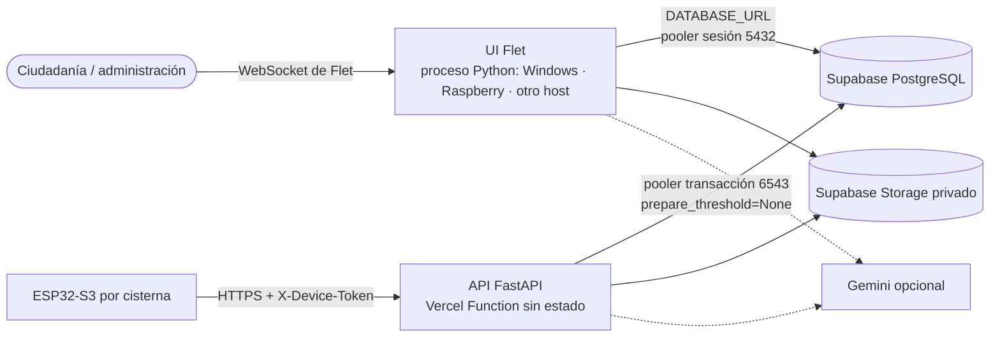

# Arquitectura de HIDRO360

> **Producto:** HIDRO360. **Entrega:** HIDRA — Reto 01 (TEAM VIFY AI). Este documento describe la arquitectura **realmente implementada**; si el código y el texto discrepan, gana el código.

Los componentes en **verde** existen y están probados por software; los **grises punteados** son futuros o no verificados en hardware.

```mermaid
flowchart LR
    C([Ciudadano<br/>mensaje de texto]):::ext --> B[Bandeja de reportes<br/>Flet / POST /reportes]:::ok
    B --> I[1 · Ingesta<br/>reglas · evidencia literal]:::ok
    I --> G[2 · Interpretación local/Gemini<br/>validada + fallback]:::ok
    G --> V[Aprobación humana de la lectura<br/>revisar · editar · confirmar]:::ok
    V --> D[3 · Sector y duplicados<br/>sugiere, nunca fusiona]:::ok
    D --> P[4 · Priorización<br/>fórmula determinista]:::ok
    P --> PL[5 · Planificador<br/>flujo máximo lexicográfico]:::ok
    PL --> O[6 · Orquestador de recomendaciones<br/>procedencia por etapa]:::ok
    O --> A[Aprobación humana<br/>aprobar · editar · rechazar]:::ok
    A --> AU[(Auditoría<br/>cadena de hashes)]:::ok
    A --> COM[Borradores de comunicación<br/>no se envían]:::ok
    A --> M[Misión<br/>flota de cisternas]:::ok

    subgraph Datos
      DB[(SQLite local)]:::ok
      TR[(Trazas JSONL<br/>cadena de hashes)]:::ok
    end
    I -.-> TR
    V --> DB
    PL --> DB
    AU --> DB

    API[API FastAPI /api/v1<br/>tokens operador / dispositivo]:::ok
    DB --- API
    API -->|GET /dispositivo/mision<br/>POST /dispositivo/eventos | ESP[8 · Terminal ESP32-S3<br/>firmware: compila, NO probada en placa]:::fut
    API --> RPI[Raspberry Pi 4<br/>scripts de despliegue, SIN probar]:::fut
    GEM[Gemini google-genai<br/>opcional · en desarrollo: cliente simulado]:::fut -.-> G
    WA[WhatsApp / audio / imagen]:::fut -.-> B

    classDef ok fill:#d9f0e3,stroke:#11643a,color:#0b3b22;
    classDef fut fill:#f0f0f0,stroke:#888,stroke-dasharray:5 4,color:#444;
    classDef ext fill:#dbeaf5,stroke:#0f4466,color:#0f4466;
```

## Principio rector

> **La IA propone; las reglas deterministas calculan; la persona aprueba; nada sensible ocurre automáticamente.**

## Arquitectura de agentes (8 roles)

Cada «agente» es un **componente con una responsabilidad acotada**. Solo dos usan un modelo de lenguaje (roles 2 y 6), y ambos **solo proponen**. Los demás son deterministas o son el propio humano.

| # | Rol | Módulo | Entrada | Salida | Herramientas | Autonomía | Guardrails | Límites | ¿Aprobación humana? |
|---|---|---|---|---|---|---|---|---|---|
| 1 | **Ingesta** | `services/ingest.py` | Texto crudo del reporte (dato **no confiable**) | Campos estructurados + **evidencia literal** | Regex, validación Pydantic | Automática (no decide nada sensible) | Texto original **inalterable**; PII redactada antes de salir; frases tipo instrucción excluidas | Extracción por regex limitada (frases fuera de patrón) | La revisión humana confirma después |
| 2 | **Interpretación local / Gemini + fallback** | `services/ia_gemini.py`, `services/ia_tareas.py` | Texto + esquema esperado | `SalidaIA` validada (o el resultado de reglas) | SDK `google-genai`, timeout, reintentos, cuota; **fallback local** | **Propone** datos estructurados | Esquema estricto (`extra=forbid`); revalidación en código (sector del catálogo, evidencia literal); si falla → `reglas(fallback)` **declarado** | Confianza del modelo **subjetiva, no calibrada**; en desarrollo no se probó con clave real | Una persona confirma la lectura |
| 3 | **Sector y duplicados** | `services/geoloc.py` | Reporte estructurado + catálogo de sectores | Sector **sugerido** (con opciones si es ambiguo) + duplicados **propuestos** | Catálogo de sectores, similitud de texto (umbral `UMBRAL_DUPLICADO=0.55`) | **Sugiere; nunca fusiona** | No fusiona; el sector ambiguo se ofrece como opciones | Referencias coloquiales fuera del catálogo | El operador decide «sí/no» |
| 4 | **Priorización determinista** | `services/prioritization.py` | Reporte confirmado | Puntaje + **desglose** y razones | Fórmula 40 % horas · 30 % población · 30 % vulnerabilidad; topes 96 h / 300 personas | **Calcula** (no es IA) | Fórmula **transparente** y versionada (`VERSION_REGLAS`); avisa horas contradictorias | Parámetros de demostración | No requiere; queda auditable |
| 5 | **Planificador de cisternas** | `services/planner.py` | Reportes priorizados + flota + capacidades | Plan de asignación **propuesto** | Flujo máximo lexicográfico (Edmonds-Karp); alternativa voraz | **Propone** | Respeta capacidad y elegibilidad; desempate **estable** | **No** modela rutas ni ETA; sectores sin reportes solo se marcan | Aprobación humana del plan |
| 6 | **Orquestador de recomendaciones** | `services/orquestador.py`, `services/workflow_ia.py` | Reporte/plan + contexto | `Recomendación` + **procedencia por etapa** | Etapas `validacion → duplicados → clasificacion → prioridad → recomendacion → asignacion`; IA **solo** en `clasificacion` y `recomendacion` | **Propone** (IA en 2 de 6 etapas) | Presupuesto `PRESUPUESTO_IA_S=20.0`; procedencia `gemini`/`reglas`/`reglas(fallback)`; **no** aprueba, cierra ni asigna | Depende de que el operador apruebe | La **misión solo nace con aprobación humana** |
| 7 | **Supervisor humano** | `interface/flet_app/admin/`, `services/workflow.py` | Propuestas de los roles 1–6 | Decisiones: confirmar · editar · aprobar · rechazar | UI de administración tras login; motivo obligatorio en ediciones | **Decide** (es el humano) | Cada operación mutante: `@operacion` = transacción (cambio + auditoría + traza); `@requiere_admin` en el backend | Sesiones/límites de tasa **en memoria**; sin HTTPS ni MFA | Es **el** punto de aprobación |
| 8 | **Terminal ESP32-S3** | `firmware/esp32s3_monitor/`, `api/main.py` | Misión asignada desde la API | Eventos: llegada · incidencia · entregado | HTTP/HTTPS, NVS (cola offline), botones táctiles | **Ejecuta y reporta**; **no** prioriza ni asigna | Token por vehículo (`X-Device-Token`, solo hash); eventos **idempotentes** por `uid`; no aprueba ni lee reportes | **Sin GPS**; firmware **compila pero no se probó en placa** | El humano asigna la misión; el ciudadano nunca ve la flota |

## Despliegue: reparto de componentes

La UI y la API comparten `services/workflow.py` y la misma base; solo cambia el proceso que las aloja. Sin `DATABASE_URL` todo corre con SQLite local (demo, Raspberry). Motivos, límites verificados de Vercel y riesgos: `docs/DESPLIEGUE.md` y `docs/DECISIONES.md` D-08.

## Reglas de la arquitectura

- `services/workflow.py` es la **única puerta** de entrada para la UI y la API; la interfaz no calcula reglas.
- Cada operación que cambia datos corre en **una transacción** junto con su entrada de auditoría.
- Trazas (cómo se ejecutó) y auditoría (qué decidió quién) son registros **distintos**, ambos con cadena de hashes.
- Máquina de estados validada en el backend (`TRANSICIONES_REPORTE`, `TRANSICIONES_PLAN`).
- Gemini propone datos estructurados; el código revalida (esquema, catálogo, evidencia); las personas deciden.
- La interfaz Flet llama a `services.workflow` en el mismo proceso (no por HTTP); la API FastAPI sirve a dispositivos e integraciones.

## Módulos

| Rol de la arquitectura | Archivo |
|---|---|
| 1 · Ingesta | `services/ingest.py` |
| 2 · Interpretación local/Gemini | `services/ia_gemini.py`, `services/ia_tareas.py` |
| 3 · Sector y duplicados | `services/geoloc.py` |
| 4 · Priorización | `services/prioritization.py` |
| 5 · Planificador | `services/planner.py` |
| 6 · Orquestador de recomendaciones | `services/orquestador.py`, `services/workflow_ia.py` |
| 7 · Supervisor humano + auditoría | `services/workflow.py`, `services/audit.py`, `interface/flet_app/admin/` |
| 8 · Terminal ESP32-S3 | `firmware/esp32s3_monitor/`, `api/main.py` |
| Comunicación (borradores) | `services/communication.py` |
| Fotos | `services/fotos.py` |
| Trazas | `services/tracing.py` |
| Equidad (Gini, Spearman) | `services/equidad.py` |
| Evaluación | `evaluation/` |
| Contratos | `models/schemas.py` (`SCHEMA_VERSION`) |
| Configuración | `config.py` (`VERSION_REGLAS`) |
